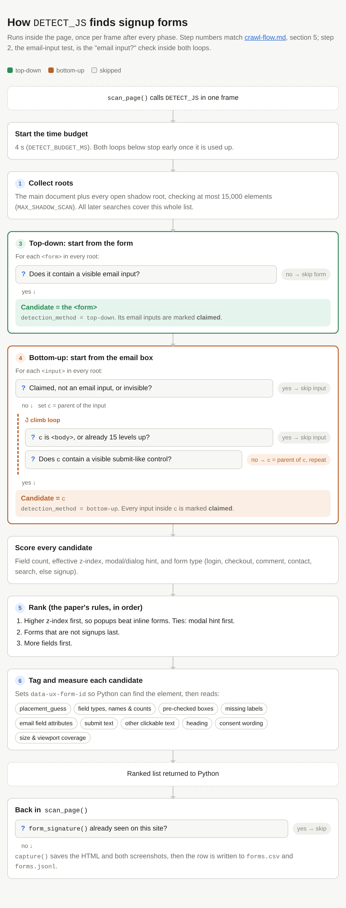

# Crawl flow

What happens from the command line to the files on disk, in order. Function
names link to the code; constants live in `src/crawler/config.py`.

```
main()
 ├─ --merge ───────────────> merge_parts() ─> exit
 ├─ --jobs N ──────────────> run_jobs() ─> N × (find_forms.py --shard i/N) ─> merge_parts()
 └─ crawl
     └─ for each site ─────> crawl_site()
                              ├─ make_driver()              fresh Chrome per site
                              ├─ scan_page(landing)
                              └─ rank_links() ─> scan_page(link) …  up to --max-pages
                                   scan_page():
                                     load ─> on_load ─> after_delay ─> after_scroll ─> after_exit_intent
                                     after each phase, in every frame: DETECT_JS ─> dedupe ─> capture() ─> write row
```

## 1. Start-up: `main()` in [find_forms.py](../src/find_forms.py)

1. **`parse_args()`** reads the options and rejects bad combinations: no site
   list without `--merge`, `--jobs` outside 1–8, `--jobs` with `--shard`. It
   warns above 4 jobs, because of RAM.
2. **Three run modes:**
   - `--merge`: run `merge_parts()` on `--out` and exit. Nothing is crawled.
   - `--jobs N` (N > 1): hand over to `run_jobs()` (section 6). This parent
     process never crawls.
   - Otherwise this process crawls, either the whole list or one
     `--shard i/N` slice.
3. **Build the site list:**
   - `load_sites()` reads the file in order and drops blank lines, `#`
     comments, a Tranco `rank,` header and duplicates.
   - `--limit N` keeps the first N sites.
   - `--shard i/N` then keeps every N-th site starting at `i`. Applying the
     limit first means shards always split the same total work.
   - Under `--jobs`, the shards split only the sites **not done yet**, so a
     resumed run keeps all N browsers busy. (Before 2026-10-11 they split the
     whole list, so every unfinished site of a shard that had stopped early went
     back to that one shard while the others sat idle.) A manual `--shard`
     keeps the fixed split, because shards on other machines cannot see each
     other's progress.
4. **Open outputs and resume.** `Output(out_dir, part)` opens `forms.csv`,
   `pages.csv` and `forms.jsonl` for appending (`*.part<i>.*` for a shard). It
   reads every `sites_done*.txt`; any site listed there is skipped.
5. **`install_stop_handler()`:** Ctrl-C or SIGTERM only sets `STOP["now"]`. The
   crawl finishes its current page and stops at the next page boundary, so rows
   are flushed and the driver is quit rather than left orphaned.

No browser is launched here: since the move to Selenium on 2026-10-21 each site
opens and quits its own Chrome inside `crawl_site()`.

## 2. The site loop

For each remaining site:

1. If `STOP` is set, stop.
2. Print `[n/total] site`.
4. Call **`crawl_site()`**, with the watchdog timing it: if the site is still
   running after `--site-time-limit` (default 2 minutes per `--max-pages`, so 6
   minutes), Chrome and chromedriver are killed, the site gets a `site_timeout`
   row, and the next site starts a fresh driver. Otherwise any exception becomes a `site_error` row in
   `pages.csv` and the run continues.
5. Call **`output.mark_done(site)`**, even after an error, so a broken site is
   not retried forever.

At the end it closes the output files first and the browser second, so a hung
browser teardown cannot lose CSV data. An interrupted run exits with code 130.
There is no delay between sites, because each site is a different host.

## 3. One site: `crawl_site()` in [crawl.py](../src/crawler/crawl.py)

1. **`normalize_site()`:** a CSV line keeps its last field, and `https://` is
   added if there is no scheme. The result is both the landing URL and the
   `site` key in every row.
2. **`make_driver()`** in [browser.py](../src/crawler/browser.py) starts a fresh
   Chrome per site, so no cookies or storage carry over. Its settings:
   - 1440×900 viewport, set through CDP rather than `--window-size`, which sizes
     the whole window; with `--hide-scrollbars`, so a scrollbar does not take
     15px out of the layout width. Both are needed for the recorded `width` and
     `viewport_coverage` to mean what they did before 2026-10-21.
   - `en-US` locale
   - HTTPS certificate errors ignored
   - `--user-agent`, if given
   - service workers bypassed, so they cannot serve around the blocking below
   - audio and video addresses blocked (`BLOCKED_URL_PATTERNS`); images, fonts
     and scripts load normally
   - `--timeout` for page loads, `SCRIPT_TIMEOUT_S` (30 s) for every script call
3. **Scan the landing page** with `scan_page()` (section 4), which returns the
   number of new forms.
4. **Follow links,** only if the landing page had no forms or `--explore` is set:
   - `LINKS_JS` collects every `<a href>` on the current page.
   - `rank_links()` keeps links that are http(s), visible, same-site, not file
     downloads, not yet visited, without "unsubscribe", "mobile" or "phone" in
     their text, and without "unsubscribe" in their address. Each is scored
     against the five `LINK_TIERS`: newsletter/subscribe text, then
     signup/register text, then a signup address (`/newsletter`, `/subscribe`,
     `/signup`, …; added 2026-10-11), then article URLs, then US locale URLs.
     Links matching no tier are dropped. How the keyword lists
     were extended on 2026-10-11 is in [link-keywords.md](link-keywords.md).
   - The ranked links are visited in order in the same tab. Before each visit
     the crawler checks `STOP` and waits `polite_sleep()` (`--page-delay` plus
     0–1 s of jitter).
   - It stops at `--max-pages` pages (default 3, landing page included).
     Without `--explore`, it also stops at the first page that produced a form.
5. **Close the context.**

## 4. One page: `scan_page()`

**Load:**

1. `driver.get(url)` returns at DOMContentLoaded (page load strategy `eager`),
   up to `--timeout` (30 s).
2. It polls `document.readyState` for at most `LOAD_SETTLE_MS` (3 s), giving the
   full load event a bounded chance.
3. It waits `PAINT_SETTLE_MS` (1 s) so on-load popups can render.
4. It records the final URL after redirects and the HTTP status, read in the page
   from `PerformanceNavigationTiming.responseStatus` (Selenium cannot see the
   response object). If loading fails, it writes a `load_error` row and returns 0.

**Four detection phases.** Each triggers popups in its own way, then detection
runs:

| Phase | Trigger | Catches |
|---|---|---|
| `on_load` | none | inline, footer and header forms; instant popups |
| `after_delay` | wait `--popup-wait` (8 s) | timed popups |
| `after_scroll` | `SCROLL_JS`: scroll down in steps of 80% of the viewport (≤ `SCROLL_BUDGET_MS`, 5 s), land on the bottom, return to the top | scroll-depth popups, bottom sticky bars |
| `after_exit_intent` | `simulate_exit_intent()`: real mouse move from the centre to the top edge, `mouseout`/`mouseleave` events, 2.5 s wait | exit-intent popups |

If a trigger fails, the error is noted on the page row and detection still runs.

**After each phase, detection runs in every frame,** including iframes, which
is how embedded signup widgets are found:

1. `DETECT_JS` (section 5) returns the ranked form candidates in that frame.
   Each run is capped at `DETECT_BUDGET_MS` (4 s).
2. For each candidate, `form_signature()` hashes stable attributes: detection
   method, frame host, email field name/id/placeholder, submit text, field
   count and heading. Position is not used.
3. If the signature is already in `seen`, the form is skipped. `seen` lasts for
   the whole site, so a footer form repeated on every page is recorded once,
   under the first phase it appeared in.
4. For a new form:
   - **`capture()`** saves `html/<site>/<sig>.html` (the outerHTML), scrolls
     the form into view, and saves `screens/<site>/<sig>.png` (the element) and
     `<sig>_context.png` (the viewport). A failed step leaves its column empty.
   - **`output.form()`** writes the row to `forms.csv` and `forms.jsonl` and
     flushes immediately.

Finally it writes one `pages.csv` row with `n_new_forms`.

## 5. Detection: `DETECT_JS` in [js.py](../src/crawler/js.py), run inside the page

Adapted from Englehardt, Han & Narayanan (2018), Section 3 and Appendix 10.1.



The step numbers in the diagram match the steps below. The image is a screenshot
of [detect-js-flow.html](detect-js-flow.html); edit the HTML, then re-render
the PNG from the repo root with:

```bash
venv/bin/python -c "from playwright.sync_api import sync_playwright; import pathlib; p = sync_playwright().start(); b = p.chromium.launch(); pg = b.new_page(viewport={'width': 820, 'height': 900}, device_scale_factor=2, color_scheme='light'); pg.goto(pathlib.Path('docs/detect-js-flow.html').resolve().as_uri()); pg.locator('main').screenshot(path='docs/detect-js-flow.png'); b.close(); p.stop()"
```

1. **Collect roots:** build the list of places where a form could be.
   - *Why:* a page is normally one tree of elements, which the browser can
     search quickly. Some parts, often embedded widgets such as a marketing
     company's newsletter popup, are sealed-off boxes called **shadow DOM**. A
     normal search of the page does not look inside them, so a form in one
     would be missed.
   - *How:* the list starts with the main page (`document`). Every element is
     checked for an attached box (`shadowRoot`). Each box found is added to the
     list and searched the same way, since boxes can contain more boxes. Each
     entry is a "root": the starting point of its own small tree.
   - *Then:* every later search ("all forms", "all inputs") runs over the whole
     list, the main page plus every box.
   - *Limits:* it stops after `MAX_SHADOW_SCAN` (15,000) elements, so boxes
     beyond that on very large pages are missed. Only *open* shadow roots can
     be searched; *closed* ones cannot be looked into at all. Iframes are
     separate pages, not shadow DOM; they are covered because `scan_page()`
     runs detection in every frame.
2. **Email-input test:** `type=email`, or a text input whose name, id, class,
   placeholder or label matches `e-?mail|newsletter` and does not match
   search, password, phone, zip or coupon. It must also be visible: at least
   2 px in size, with no ancestor that is `display:none`, `visibility:hidden`
   or `opacity:0`.
3. **Top-down detection: start from the form, look for an email box inside.**
   - *Idea:* the normal way to build a signup form is a `<form>` tag around the
     fields and the button. So look at every `<form>` and ask: "is there an
     email box inside you?"
   - *How:*
     1. Find every `<form>` in every root from step 1.
     2. Inside each one, find the `<input>`s that pass the email-input test and
        are visible.
     3. If there is at least one, the whole `<form>` becomes a candidate,
        recorded with `detection_method = top-down`. The first such input is
        "the email field" whose attributes are reported.
     4. Those email inputs are marked as *claimed*, so bottom-up does not
        report the same form again.
   - *Example:*
     ```html
     <form action="/subscribe">
       <label for="em">Email</label> <input type="email" id="em">
       <button>Subscribe</button>
     </form>
     ```
     The `<form>` is the candidate. Its screenshot, field count and text all
     come from the `<form>` element.
   - *Notes:* top-down does not require a submit button; an email box inside a
     `<form>` is enough. A `<form>` with no visible email box (a search bar, a
     login form with a "Username" box) is ignored.
   - *Limit:* some sites, notably ASP.NET WebForms, wrap the **entire page** in
     one `<form>`. The candidate is then the whole page: the screenshot covers
     the page and the field count includes unrelated boxes such as search.
     These rows are easy to spot by their size and should be recoded by hand.

4. **Bottom-up detection: start from the email box, look for its button.**
   - *Idea:* many modern sites build forms without a `<form>` tag, just
     `<div>`s with JavaScript that sends the email when the button is clicked.
     Top-down cannot see these. So start from an email box and climb up the
     page structure until the "box" around it also contains a button.
   - *How:*
     1. Find every `<input>` in every root that passes the email-input test,
        is visible, and was **not** claimed by top-down (so in practice, email
        boxes outside any `<form>`).
     2. Step up to its parent element and check: does this element contain a
        visible *submit-like* control (step 4a)?
     3. If not, step up again, at most **15 levels**. Stop at `<body>`: a box
        that needs the whole page to find a button is not a form.
     4. The **first** element that contains a submit-like control becomes the
        candidate, recorded with `detection_method = bottom-up`. Taking the
        first, smallest one keeps the candidate tight around the form instead
        of a whole page section.
     5. Every input inside that element is claimed, so a second email box in
        the same widget does not create a second candidate.
   - *Example:*
     ```html
     <div class="newsletter">            <- candidate (level 2)
       <div class="row">                 <- level 1: no button here
         <input placeholder="Your email">
       </div>
       <span class="btn" style="cursor:pointer">Sign me up</span>
     </div>
     ```
     There is no `<form>`, so top-down finds nothing. Bottom-up starts at the
     input, finds no button in `.row`, goes up one more level, and finds "Sign
     me up" in `.newsletter`. That `<div>` is the candidate.
   - *Shadow DOM:* when the climb reaches the top of a shadow root, it
     continues from the element hosting that root, so a widget split across a
     shadow boundary is still found.
   - *Limit:* if the button is more than 15 levels above the email box, or is
     not recognised as submit-like (for example an icon-only button with no
     text or label), the form is missed.

   **4a. What counts as "submit-like":** checked for at most 300 elements per
   level, and the element must be visible.
   - a `<button>` of any type except `reset`
   - `<input type="submit">` or `<input type="image">`
   - `<input type="button">` whose text matches the submit words below
   - an `<a>`, `<div>`, `<span>` or `role="button"` element that has at most
     two child elements, has visible text of 40 characters or less matching
     the submit words, and looks clickable (`role="button"`, a link, or a
     `cursor: pointer` style)

   Submit words: *subscribe* (and *subscription*, …), *sign up*, *sign me up*,
   *join*, *submit*, *send*, *notify*, *register*, *get*, *continue*, *next*,
   *save*, *count me in*, *yes*, *go*, *ok*, plus the stems *suscr…* (Spanish
   *suscribirse*, *suscríbete*) and *inscr…* (Portuguese *inscreva-se*, French
   *s'inscrire*). *next*, *save* and the two stems were added on 2026-10-11 from
   the button texts of 146 known signup pages; see
   [link-keywords.md](link-keywords.md).

   **Top-down and bottom-up together.** The paper used bottom-up only as a
   fallback when top-down found nothing on a page. Here both always run, and
   every candidate from either one goes into the same ranking (step 5). The
   `detection_method` column records which approach found each form.
5. **Ranking: put the forms in order, most important first.**
   - *Why:* one page often has several forms, for example a popup, a footer
     signup and a login box. Ranking decides which one comes first. The order is
     saved in the `rank_on_page` column (1 = first).
   - *Nothing is thrown away.* Every form found is still recorded. Ranking only
     sets the order. (The paper ranked forms to pick one to sign up with; we
     keep them all.)
   - *The rules,* checked one after another. A later rule is only used when
     two forms are tied on all the earlier ones.
     1. **On top first.** Each part of a page has a z-index, a number that says
        how far "in front" it sits. A popup covering the page has a high one;
        a normal form in the page has none. The form that sits most in front
        comes first, so popups beat inline forms. To find a form's z-index the
        code looks at the form, then its parent, then its parent's parent, and
        so on, and uses the first z-index it finds. If none is set, it counts
        as 0.
     2. **Popups next.** If two forms are equally far in front, one that looks
        like a popup comes first. It "looks like a popup" when it, or one of the
        10 elements above it, is a `<dialog>`, is marked as a dialog for screen
        readers (`role="dialog"`, `aria-modal="true"`), or has a class or id
        containing *modal*, *dialog*, *popup*, *lightbox*, *overlay*,
        *flyout* or *slide-in*. As a last resort, the words *modal* or
        *dialog* anywhere in the form's HTML also count. Saved as `modal_hint`.
     3. **Non-signup forms last.** Every form with an email box is recorded,
        but many are not signups. `FORM_TYPES` in `config.py` classifies each
        one into `form_type`, and anything that is not a `signup` goes after
        the signups. The types are tried in this order, first match wins:

        | Type | Matches on |
        |---|---|
        | `login` | a password box; *log in* / *login* / *sign in* / *signin* as a word in the form's HTML or the text around it; or a login/account page address (`auth.`, `/login`, `/account`, …) |
        | `checkout` | *checkout*, *card number*, *cvv*, *billing address*, *place your order*, … |
        | `comment` | *leave a reply*, *post a comment*, *your comment* |
        | `contact` | *contact us*, *get in touch*, *send us a message*, *enquiry*, … |
        | `search` | a search box, or the word *search* |
        | `signup` | **the fallback**: matched none of the above |

        A rule can also carry an `unless` blacklist that cancels a match.
        `login` uses one so a newsletter box reading "Already subscribed? Sign
        in" stays a signup; `contact` and `search` use one so a footer that
        mentions both a newsletter and getting in touch stays a signup.

        `form_type` replaced the boolean `login_like` on 2026-10-22; the
        `login` rules are the same three signals that column used, so login
        classification did not shift. The address rule dates from 2026-10-11:
        two-step logins ask for the email first and show the password box only
        on the next screen, which the crawler never reaches, so the address is
        often the only clue.
     4. **Bigger forms first.** If still tied, the form with more fields comes
        first. Text boxes and checkboxes count one each; a group of radio
        buttons counts as one. Saved as `n_fields`.
   - *Example:* a page has a newsletter popup (z-index 9999), a footer signup
     (no z-index) and a header login (no z-index). Rule 1 puts the popup first.
     The footer form and the login form are tied at 0 and neither looks like a
     popup, so rule 3 puts the login form last, because its `form_type` is not
     `signup`. Result: popup = 1, footer = 2, login = 3.
   - *Things to know when using `rank_on_page`:*
     - Ranking happens **per frame, per phase**. A form inside an iframe is
       ranked only against the other forms in that iframe, and a popup that
       appears in a later phase is ranked only against what the detector sees
       at that moment. So `rank_on_page = 1` means "first in that frame at that
       moment", not "the main form of the page".
     - The checks are simple word matches, so they can be wrong. The `unless`
       blacklists cover the confusions seen so far, but a newsletter footer on
       an account page is still typed `login`, because the address rule fires
       whatever the form itself says. Like the other heuristic columns, check
       `modal_hint` and `form_type` against the screenshots.
6. **Tag and measure:** each candidate gets a `data-ux-form-id` attribute so
   Python can find it for screenshots, and returns:
   - **position:** `placement_guess` (fullscreen takeover, sticky bar top or
     bottom, modal popup, slide-in, footer, header, sidebar, inline, …)
   - **fields:** field types and names (`field_types`, `field_names`) and counts, checkboxes and how many are
     pre-checked, fields with no label, the email field's attributes
   - **surrounding text:** submit text, other clickable text (e.g. "No
     thanks"), heading, consent wording
   - **size:** width, height, viewport coverage

## 6. Parallel runs: `--jobs N`, in [jobs.py](../src/crawler/jobs.py)

1. `run_jobs()` relaunches the script N times with `--shard i/N`, half a second
   apart.
2. It collects each child's output and prefixes every line with `[s<i>]`.
3. **First Ctrl-C:** every shard gets SIGINT and up to `SHUTDOWN_GRACE` (90 s) to
   finish its page and flush. A second Ctrl-C terminates the shards; a third
   kills them.
4. When all shards have exited, `merge_parts()` in
   [output.py](../src/crawler/output.py) appends rows from the `*.part*` files
   into the main files, skipping duplicates by `(site, form_sig)`. It refuses to
   merge a file whose columns differ from the current schema. Part files are
   kept, so the merge can be rerun at any time.

## Timing

A page takes roughly 15–20 s: about 4 s of load and settle, 8 s popup wait, up
to 6 s of scrolling, about 3 s of exit intent, plus detection and screenshots.
With the default `--max-pages 3`, a site takes 15–60 s plus the polite delays.
